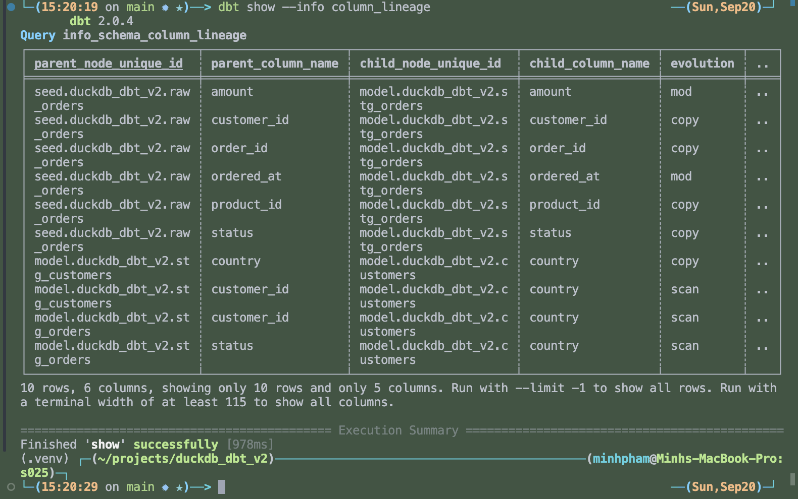
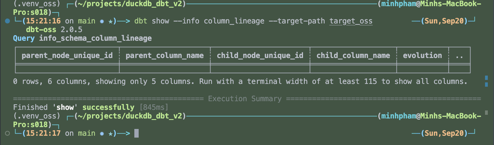
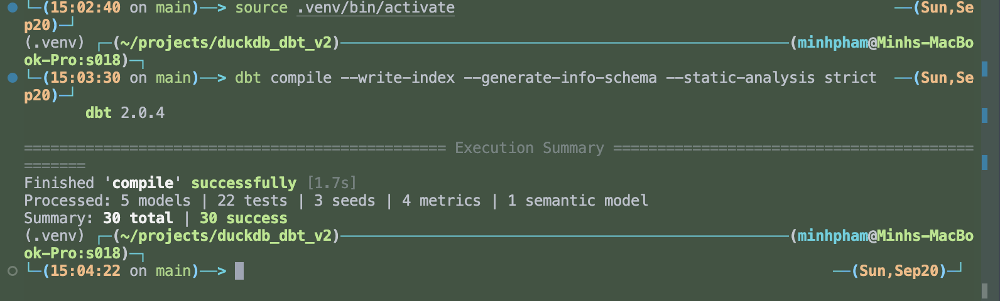
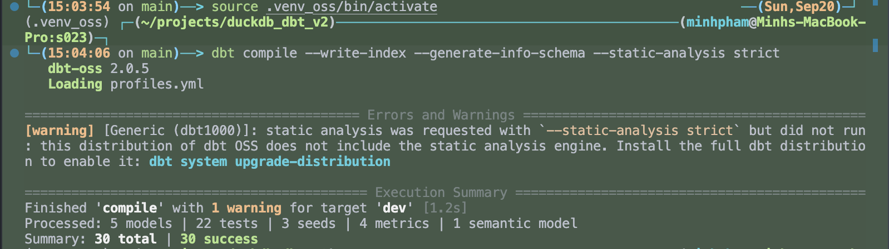
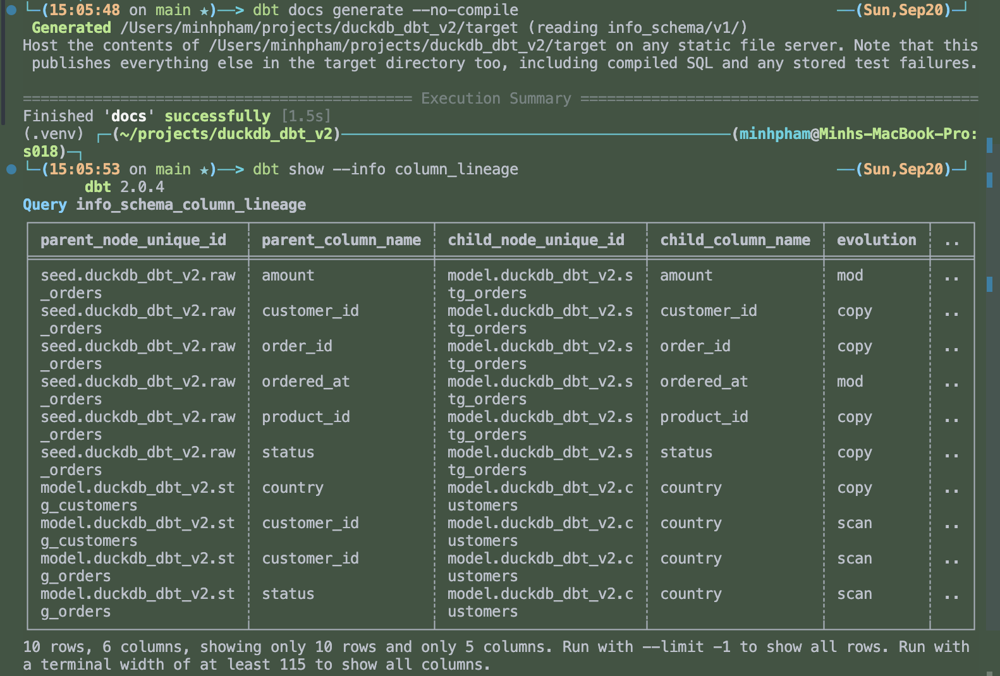
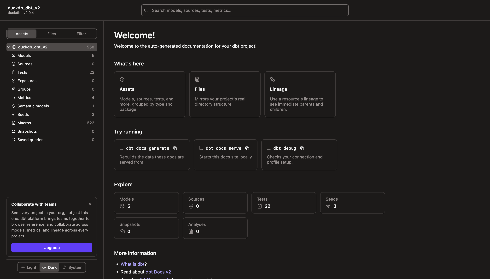
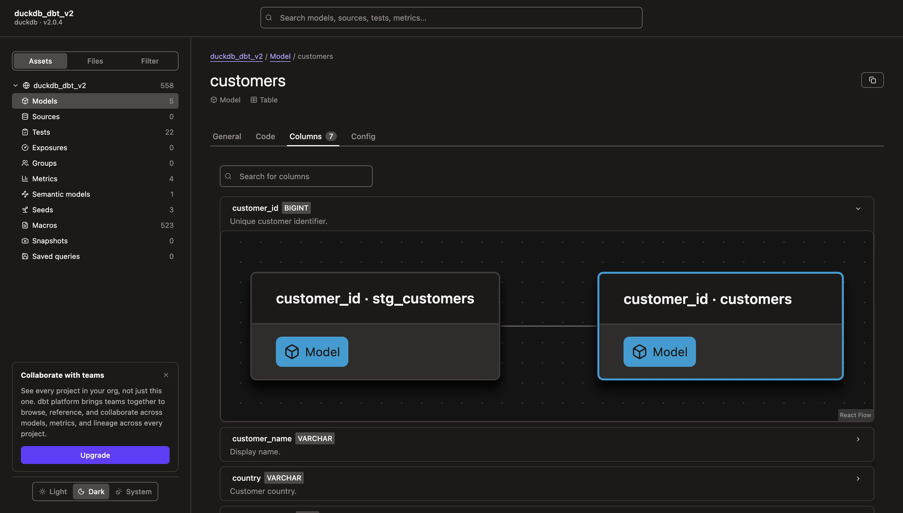
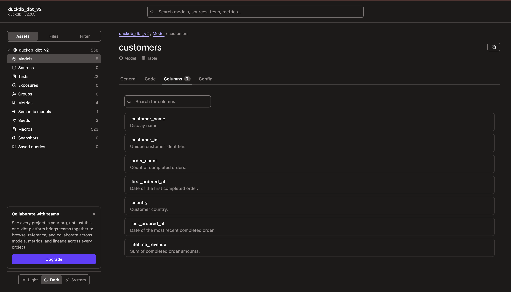
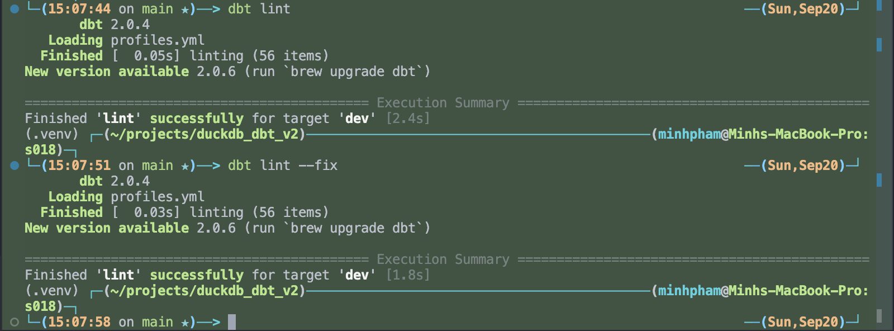

# dbt v2 vs dbt v2 OSS

A small DuckDB sample that compares the two local dbt **v2** installs: full `dbt` (formerly Fusion) and Apache 2.0 `dbt-oss`. 

DuckDB is CLI-only in v2 and is bundled with both `pip install dbt` and `pip install dbt-oss`. The project files are the same; the rest of this README is what each binary can do with them.

## Distributions

v2 ships two local installs:

| | Full `dbt` (`.venv`) | `dbt-oss` (`.venv_oss`) |
|---|---|---|
| License | dbt Product License | Apache 2.0 |
| Pin file | `requirements.txt` (`dbt==2.0.4`) | `requirements-oss.txt` (`dbt-oss==2.0.5`) |
| `dbt build`, Docs v2, Information Schema | Yes | Yes |
| `--static-analysis strict` CLI flag | Runs the engine | Accepted, then skipped with a warning |
| Column types and column-level lineage | Yes, after a strict compile | Cannot **compute** them. `dbt show --info` only reads existing Parquet; Docs v2 hides the graph |
| `dbt lint`, LSP / VS Code SQL comprehension | Yes | No |

OSS includes the Docs v2 site and table-level DAG. Column-level lineage needs the static analysis engine, which is only in the full `dbt` package.

### What compile and static analysis mean

In dbt v1, `compile` only **rendered** Jinja: `ref()`, `source()`, and macros became a SQL string you could send to the warehouse. dbt v2 still does that, then can run a second step called **static analysis**.

Static analysis means checking SQL **before it runs**. dbt builds a logical plan for each rendered query, walks the DAG, and figures out column names, types, and how a column in `customers` traces back to `stg_customers` or a seed. DuckDB never has to execute the model for that metadata to exist. Your database can only validate the query in front of it; v2 can analyze every query from one end of the project to the other.

Three modes:

| Mode | What it does | What you get |
|---|---|---|
| `off` | Skip analysis on that model and everything downstream | Table-level DAG only. No SQL comprehension. |
| `baseline` (default) | Analyze rendered SQL. Catch most syntax errors. Do not require a full local schema. Findings are warnings, so the run can continue. | Syntax checks, CTE preview, unit tests. No column-level go-to-definition, no type errors, no column-level lineage. |
| `strict` | Analyze **all** SQL and prove the project valid **before** anything executes | Column types, function-signature checks, column-level lineage, column rename/refactor in the LSP |

`--static-analysis` on the CLI overrides model-level `static_analysis` for that one command. This sample leaves the project at the default (`baseline`) and turns `strict` on only when you want lineage artifacts.

`dbt docs generate` has **no** `--static-analysis` flag. If you generate docs in a normal compile (baseline), Docs v2 still builds, but `dbt.node_columns` / `dbt.column_lineage` stay empty and the Columns tab has no graph. That is why the lineage path is two steps: compile in `strict` first, then export docs without compiling again.

```bash
# Full dbt: populate lineage, then export Docs v2 without recompiling in baseline
dbt compile --write-index --generate-info-schema --static-analysis strict
dbt docs generate --no-compile
dbt show --info column_lineage
```

What those flags do:

- `--static-analysis strict` — run the engine described above. This is the step that fills column types and lineage.
- `--generate-info-schema` — write that metadata as Parquet under `target/info_schema/v1/` (`dbt.node_columns`, `dbt.column_lineage`, and the rest of the Information Schema). `dbt show --info column_lineage` only **reads** those files. It does not run the engine and does not hit DuckDB.
- `--write-index` — write the compact Docs v2 index (the files the browser queries with DuckDB-WASM). `--no-compile` on `docs generate` reuses that index instead of compiling again in `baseline` and wiping the strict metadata.

### `--target` is not the artifacts folder

`--target` picks a **connection** from `profiles.yml`. `--target-path` picks the **directory** where dbt writes compiled SQL, Docs v2, and `info_schema`. `--target-dir` is not a flag.

This sample has one connection, `dev` (the default):

```yaml
duckdb_dbt_v2:
  target: dev
  outputs:
    dev:
      type: duckdb
      path: ./database/duckdb_dbt_v2.duckdb
```

| Flag | Selects | Valid value here | Does not select |
|---|---|---|---|
| `--target` / `-t` | Profile output (warehouse) | `dev` | A folder on disk |
| `--target-path` | Artifacts directory | `target` (default) or `target_oss` | Which DuckDB file to open |

`--target target_oss` is a profile name that does not exist. `dbt show --info` can still print a table because it only reads Parquet and does not need that connection — but it keeps using the default `target/` folder. After a full-`dbt` strict compile, that folder already has lineage, so switching to `.venv_oss` and running `dbt show --info column_lineage` (or `--target target_oss`) still shows rows OSS never computed.

Full `dbt` reading `target/` after a strict compile:

```bash
dbt show --info column_lineage
```



Point OSS at its own tree. The command succeeds; the view is empty because OSS never wrote those rows:

```bash
dbt show --info column_lineage --target-path target_oss
```



Full `dbt` runs the engine:



`dbt-oss` accepts the same flags so scripts stay portable, then skips the engine and warns. Compile still finishes. You get rendered SQL, a Docs v2 site, and a table-level DAG — not column types or column-level lineage.



```text
static analysis was requested with `--static-analysis strict` but did not run:
this distribution of dbt OSS does not include the static analysis engine.
```

After a strict compile, `dbt docs generate --no-compile` writes Docs v2 and `dbt show --info column_lineage` prints parent/child columns. `evolution` is `copy` when the column is passed through and `mod` when it is transformed (for example `cast(amount as decimal)`):



Docs v2 home:



Column-level lineage on `customers` is visible in full `dbt`:



OSS Docs v2 still lists columns but hides lineage:



## Setup

Full dbt (recommended for lineage and lint):

```bash
python3 -m venv .venv
source .venv/bin/activate
pip install -r requirements.txt

export DBT_PROFILES_DIR="$PWD"
dbt --version          # dbt 2.0.4
dbt debug
dbt build
dbt show --select orders --limit 10
dbt lint
dbt docs generate
```



dbt OSS (Apache 2.0 runtime only):

```bash
python3 -m venv .venv_oss
source .venv_oss/bin/activate
pip install -r requirements-oss.txt

export DBT_PROFILES_DIR="$PWD"
dbt --version          # dbt-oss 2.0.5
dbt build --target-path target_oss
dbt docs generate --target-path target_oss
dbt show --info column_lineage --target-path target_oss
```

`dbt sl validate` needs a dbt platform project. This sample still defines Semantic Layer YAML so you can inspect metrics with:

```bash
dbt list --resource-type metric
dbt list --resource-type semantic_model
```

## Project

Seeds load a tiny cafe dataset. Staging models clean it. Marts are `customers` and `orders`.

| Layer | Models |
|---|---|
| seeds | `raw_customers`, `raw_orders`, `raw_products` |
| staging | `stg_customers`, `stg_orders`, `stg_products` |
| marts | `customers`, `orders` |

`orders` uses the latest Semantic Layer spec: simple metrics (`order_count`, `revenue`, `average_order_value`) plus a derived metric (`revenue_per_order`).
